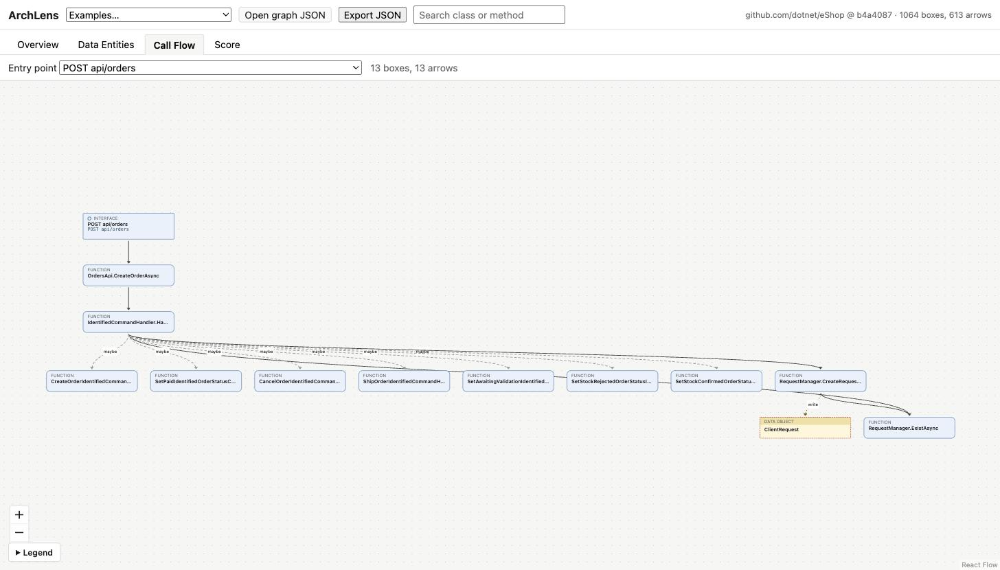

# ArchLens

Point it at a C# or Python repo and get an ArchiMate-style architecture diagram: projects, services, HTTP
entry points, data entities, outside systems, and the arrows between them. No manual modeling.



**Core rule:** static analysis finds the facts (what exists, what calls what). The optional LLM step only labels
boxes the rules were unsure about. It can never add, remove or move an arrow, and every arrow carries the file
and line that proves it.

## Quick start

Needs the .NET 10 SDK, Node 20+ and git. Python repos also need Python 3.10+ on the PATH (standard library only).

```bash
# terminal 1: the API (clones and analyzes repos), http://localhost:5080
dotnet run --project src/ArchLens.Api

# terminal 2: the viewer, http://localhost:5173
cd viewer && npm install && npm run dev
```

Open the viewer, paste a public GitHub URL (for example `github.com/dotnet/eShop`), and the graph is built on the
spot. There's also a CLI that writes the same JSON to a file:

```bash
dotnet run --project src/ArchLens.Cli -- analyze github.com/dotnet/eShop --out eshop.json
dotnet test
```

CLI options: `--include-tests` (test projects are skipped by default), `--max-depth N` (call flow depth, default 8),
`--enrich` (LLM step, needs `ANTHROPIC_API_KEY`, see below).

## The web API

| Method | Path | Does |
|---|---|---|
| POST | `/api/analyses` | Body `{"repoUrl": "github.com/owner/name"}`. Queues a job, returns `202` with its id. Anything that isn't a public github.com repo is a `400`. |
| GET | `/api/analyses/{id}` | Status (`queued`, `cloning`, `analyzing`, `done`, `failed`), a progress message, the commit, elapsed time. |
| GET | `/api/analyses/{id}/graph` | The graph JSON once done (`409` before that). |

A single background worker takes jobs off an in-process queue (`System.Threading.Channels`) one at a time: it
asks GitHub for the latest commit (`git ls-remote`), serves the cached graph if that commit was already analyzed,
otherwise shallow-clones, analyzes, caches and deletes the clone. The viewer polls the job every 700 ms. Jobs and
the cache live in memory, so a restart clears them.

## How it works

```
1 Load      one Roslyn compilation per .csproj, project references wired up, no NuGet restore
2 Collect   one pass over every file: DbSets, DI registrations, routes, HttpClient base URLs, migrations...
3 Classify  rules pick one of 10 fixed box types; entity score decides "is this data?"
4 Build     walk every method body: calls, data access, HTTP calls -> arrows with file:line evidence
5 Enrich    (optional) LLM labels only the boxes the rules marked unsure (confidence 0.5)
6 Trace     depth-first call flow from every HTTP entry point, stored in the JSON
7 Score     100 minus penalties from fixed graph checks
```

Steps 1 to 4, 6 and 7 are deterministic: the same commit always gives the same JSON (there is a test for this).

| Code | Becomes |
|---|---|
| `.csproj` | Application Component |
| Controller action, `MapGet/MapPost/...` route (with `MapGroup` prefixes) | Application Interface |
| Class with logic | Application Service (confidence 0.9 if DI-registered or implements a repo interface, else 0.5) |
| Method with a body | Application Function |
| Class with entity score >= 5 (2 to 4 = unsure) | Data Object (kind: stored / DTO / external) |
| Class deriving from `DbContext` | Technology Service |
| `HttpClient` call | External System, named from the URL or the `AddHttpClient<T>` base address |

| Arrow | Detected from |
|---|---|
| Serving | a method call or method passed as a delegate; interface calls follow DI registrations, else every implementation at confidence 0.5; `mediator.Send(cmd)` follows to the `IRequestHandler<Cmd>` |
| Access (read/write) | `DbSet` use (`Add/Update/Remove` = write), `context.Remove(x)`, setting a property on a stored entity, `GetFromJsonAsync<T>` |
| Flow | `HttpClient` calls to an External System |
| Aggregation | a data object's collection property of another data object |

Entity score (from the design doc): ORM mapping +5, table in a migration/.sql +5, used in a repository +3,
crosses an HTTP boundary +2, 80%+ data members +2, data-ish name suffix +1, logic suffix (Service, Handler...) -5.

Architecture score checks: class cycles (Tarjan SCC), entry points touching stored data directly, god classes
(over 3x the median call count and at least 10), private functions nothing calls, entities written from 3+
projects. Each check is capped so one problem can't zero the score.

## Python repos

A repo with no `.csproj` and some `.py` files goes to the Python front end (`python/archlens_py`, standard
library `ast` only; nothing in the analyzed repo is imported or run). It prints the same boxes and arrows as JSON;
the C# side reads them and runs the same tracer and score, so the API, the viewer and the CLI work unchanged.

| Code | Becomes |
|---|---|
| Top-level package (namespace sub-packages without `__init__.py` included) | Application Component |
| FastAPI `@router.get(...)`, Flask `@bp.route(...)`, full path from `APIRouter(prefix=)`, `include_router(prefix=)`, `register_blueprint(url_prefix=)`; one handler serving GET and POST is one box, `GET,POST path` | Application Interface |
| Module with routes | Application Interface (the "controller") |
| Module with functions, class with logic | Application Service (0.9 if returned by a `Depends` provider or subclassing a repo base class, else 0.5) |
| Function or method with a body | Application Function |
| Class with entity score >= 5 (2 to 4 = unsure) | Data Object |
| `requests` / `httpx` / `urlopen` call | External System, named from the URL or the client's `base_url` |

| Arrow | Detected from |
|---|---|
| Serving | calls resolved through imports (re-exports followed), `self.x` typed from `__init__` annotations or constructors, parameter annotations, `-> T` return annotations; `Depends(provider)` in a signature or an `Annotated` alias (`SessionDep`); an abstract or ABC method goes to every implementation at 0.5 (1.0 if only one) |
| Access (read/write) | `select(Order)`, `session.query/get(Order)`, `Order.objects` / `Order.query` managers; `session.add/delete/merge(order)`, `order.status = ...` and a repo method that returns nothing on a stored entity are writes; `Model.model_validate(...)` is a read only when the same function made an HTTP call |
| Flow | an HTTP call to an External System |
| Aggregation | `list[OrderLine]` / `Mapped[list["OrderLine"]]` on a data object |

Entity score uses the C# table: ORM mapping (SQLAlchemy `DeclarativeBase` / `declarative_base()` with a table,
SQLModel `table=True`, Django and Flask-SQLAlchemy models) +5, table created in a migration or `.sql` file +5,
used in a `*Repository` class or a `crud`/`repository` module +3, Pydantic model or route parameter/response type
+2, 80%+ fields +2, data-ish name suffix +1, logic suffix -5. Exceptions and enums are never data.

Measured the same way as the C# table below (Apple M5, local clone, three runs, identical output each run):

| Repo (commit) | Components | Boxes | Arrows | Entry points | Time |
|---|---|---|---|---|---|
| fastapi/full-stack-fastapi-template (`f27b472`) | 3 | 96 | 103 | 23 | 0.1 s |
| miguelgrinberg/microblog (`a975ef6`, Flask) | 2 | 99 | 51 | 27 | 0.1 s |
| netflix/dispatch (`dd2837e`, 717 .py files) | 3 | 2,726 | 3,775 | 290 | 0.8 s |

**Spot check, not a graded benchmark.** 30 random arrows from the final version (10 per repo, seed 99) were each
opened at their evidence line: all 30 were real calls or accesses. An earlier 40-arrow sample found three wrong
ones, which led to two fixes (Flask multi-method routes as one box; a root `tests.py` counted as tests).

## Results on real repos

Measured on an Apple M5 laptop, local clone, `--enrich` off.

| Repo (commit) | Projects | Boxes | Arrows | Entry points | Time |
|---|---|---|---|---|---|
| dotnet/eShop (`b4a4087`) | 19 | 1,064 | 613 | 50 | 2.9 s |
| dotnet-architecture/eShopOnWeb (`4da8212`) | 6 | 369 | 166 | 32 | 1.2 s |
| jasontaylordev/CleanArchitecture (`5353a9e`) | 7 | 162 | 75 | 10 | 0.8 s |

The graph JSON for each is in `eval/` and bundled in the viewer's example list.

**Precision check.** `archlens sample-edges graph.json --count 30 --seed 42` writes a checklist of random arrows,
each linked to its evidence line on GitHub. `eval/eshop-edge-check.md` (seed 42) is the held-out sheet and has
not been graded yet. Two development samples (seed 1) were used to find bugs; see `eval/README.md`.

## Tests

- `tests/ArchLens.Tests` (xUnit, 67 tests): the SampleShop fixture (`samples/SampleShop`) is a small app written
  for this. Its expected arrows, routes and entity scores are worked out by hand from its source and compared as
  sets, so an extra arrow fails the test as much as a missing one. Also: interface/DI/abstract/MediatR
  resolution on tiny generated repos, Tarjan, the tracer, score caps, the LLM step with a fake client, and the
  web API end to end in memory (a fake git source copies the fixture instead of cloning).
- `tests/ArchLens.Tests` also runs the Python front end on `samples/SamplePyShop` (6 tests): language detection,
  the JSON hand-off, the traced flow and the score (79, the same checks as SampleShop).
- `python/tests` (pytest, 21 tests): the SamplePyShop fixture (FastAPI, SQLAlchemy, Pydantic, httpx, an ABC with
  two implementations, an Alembic migration) with its exact arrow set worked out by hand, like SampleShop.
- `viewer` (vitest, 37 tests): the pure logic in `viewer/src/lib`.

## Known limitations

- **No NuGet restore.** Package types (EF Core, MediatR) don't resolve. Repo code still resolves, and package
  calls are matched by receiver type and name. But `var x = await db.Items.FirstAsync()` has an unknown type,
  so a later `x.Name = ...` is not seen as a write.
- Not detected: gRPC, message bus publish/subscribe (Triggering arrows), Realization arrows, route prefixes
  built by reflection, runtime-only dispatch (reflection, generic handler chains).
- MVC controllers without `[Route]` are assumed to use the default `{controller}/{action}` template.
- The LLM step (`--enrich`) is unit tested with a fake client only. It has not yet been run against the live
  API. It uses the official Anthropic C# SDK with a JSON schema whose `type` field is an enum of the 10 box
  types; a refusal or cut-off answer keeps the rule's label.
- Python: types are only known from annotations, constructors and `-> T` returns, so calls on untyped variables
  are not drawn (precision over recall). Django URLconfs, class-based views, Celery task dispatch and dynamic
  `getattr` calls are not followed. Route prefixes that are only known at runtime show as `{expression}`.
  `--enrich` is C#-only for now (the LLM step reads Roslyn's index).
- The design doc's TypeScript support, Infrastructure view, Postgres storage, Server-Sent Events
  progress (the viewer polls instead), PNG/SVG export and CI score are not built. Jobs and the cache are in memory.

## Deliberate differences from the design doc

- **Serving arrows point caller -> callee.** ArchiMate draws Serving from provider to consumer. Call flows read
  top to bottom, so ArchLens stores the call direction.
- **Cycles are checked per class, not per project.** MSBuild refuses circular project references, so a
  project-level cycle check would always pass.
- **Unsure entities are still drawn** (dashed, hidden by default in the Data view) when the LLM step is off,
  instead of being dropped.
